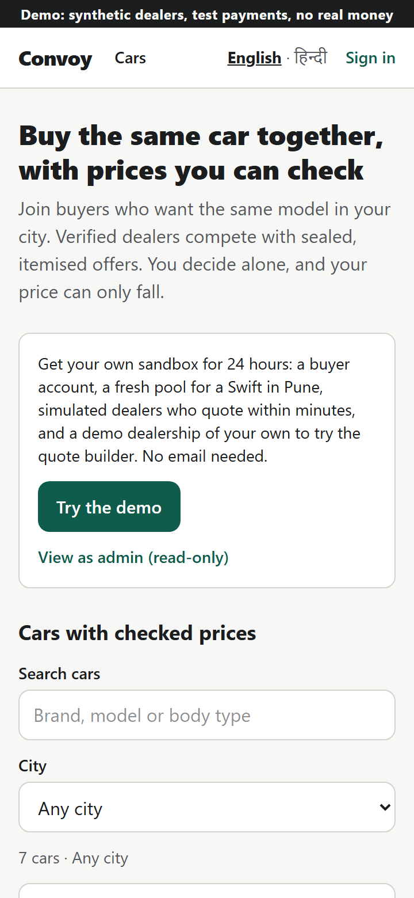
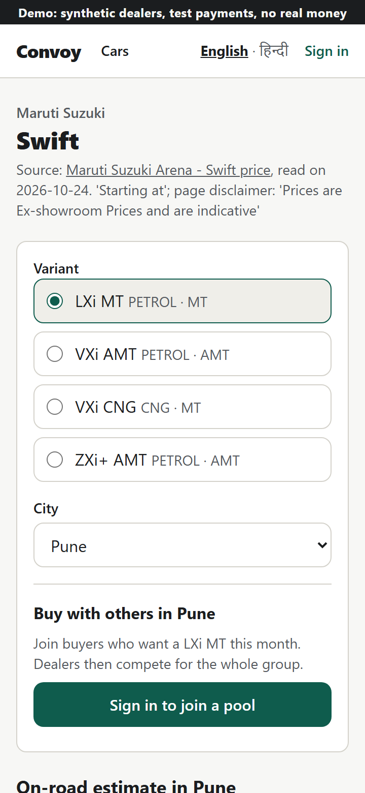
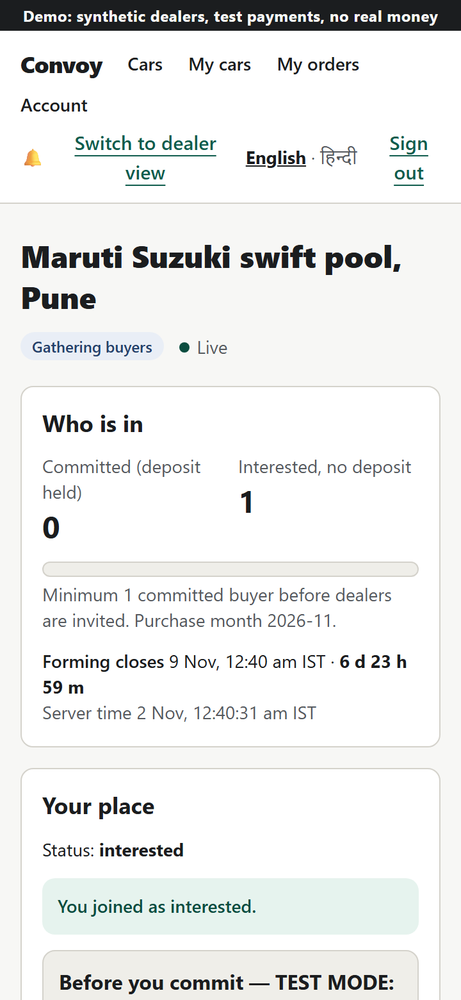
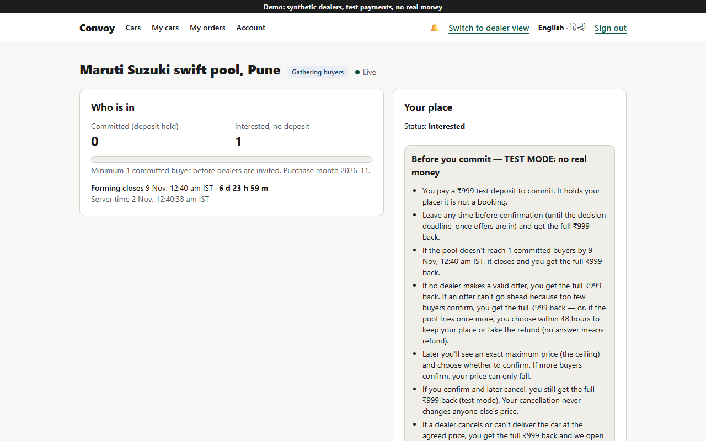
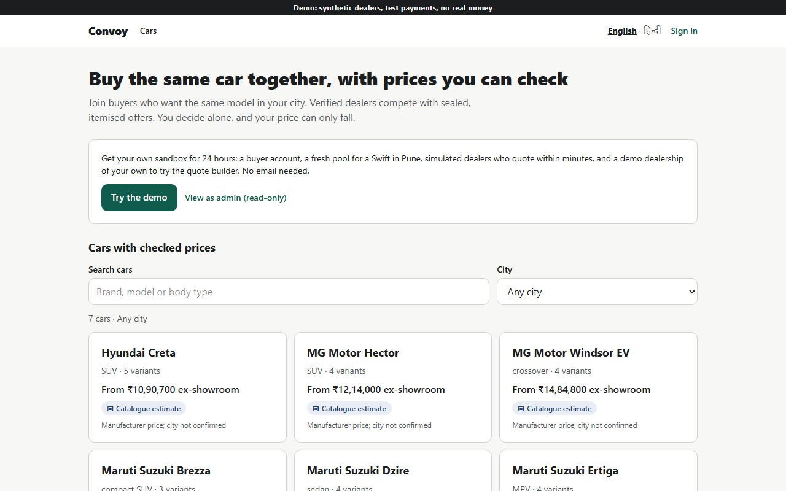
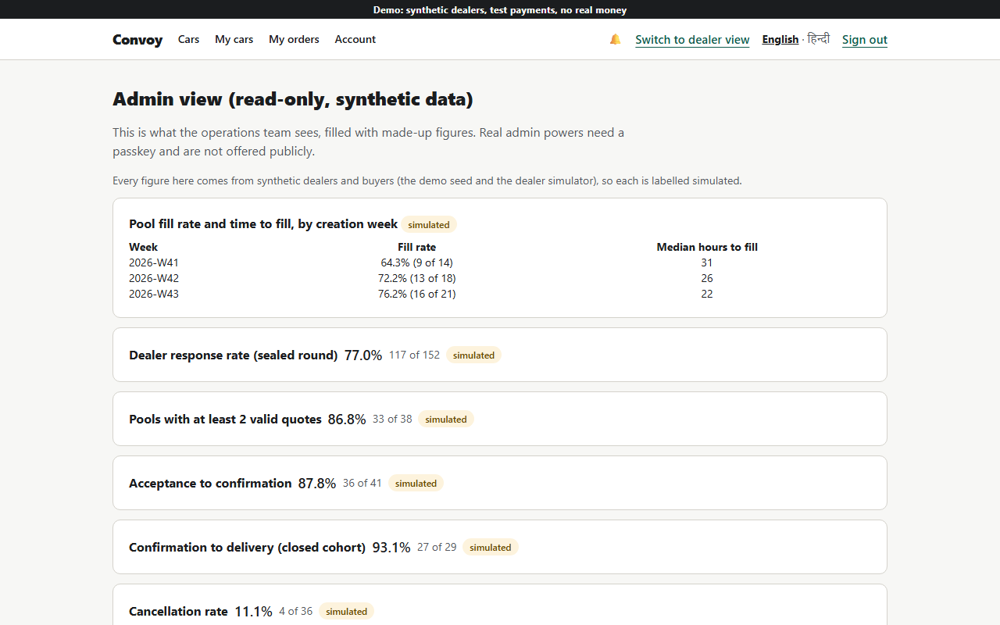

# Convoy

**Group car buying where the price can only fall.** People who want the same car in the same city join a pool and leave a
refundable deposit. Verified dealers then compete with sealed, itemised offers (ex-showroom, road tax, insurance, add-ons),
each priced in tiers: the more buyers confirm, the lower the price. Every buyer confirms alone at the offer's ceiling (the
highest price it can ever be), and the final tier can only bring that price down. Convoy is a portfolio project built
to production standards: microservices, events, a saga, real deployment, measured evidence. It runs in **test mode only**.

## Live demo

**https://convoy-main.duckdns.org**

1. Open the site and press **Try the demo**. No email is needed: you get a 24-hour sandbox with a buyer account, a
   fresh pool for a Swift in Pune and a demo dealership of your own.
2. Join the pool and commit with the **₹999 test deposit** (a simulated payment; no real money moves).
3. Simulated dealers quote within minutes. Open **Compare offers**, accept one, then confirm on **My orders** to get a
   booking voucher.
4. Use **Switch to dealer view** to see the quote builder from the dealer's side, and **View as admin (read-only)**
   for the operations dashboard with synthetic figures.

| | |
|---|---|
|  |  |
| Discover (360 px) | Model page: variants with a cited price source, city, join a pool (360 px) |
|  |  |
| Pool, live counts over SSE (360 px) | Pool and the deposit terms (desktop) |
|  |  |
| Discover (desktop) | Read-only admin view, every figure labelled simulated |

Screenshots of the live site, 2026-11-02.

## Architecture



Source: [`docs/architecture/overview.mmd`](docs/architecture/overview.mmd) (render with
`cd web && node scripts/render-mermaid.mjs ../docs/architecture/overview.mmd ../docs/architecture/overview.svg`).
The walkthrough is in **[docs/ARCHITECTURE.md](docs/ARCHITECTURE.md)**.

## Tech stack

- **Services:** Java 21, Spring Boot 3.5, Spring Cloud Gateway, Flyway, Resilience4j; one PostgreSQL 16 schema per service.
- **Messaging:** SNS topics → SQS queues with DLQs (LocalStack on the laptop), transactional outbox and inbox.
- **Realtime:** Server-Sent Events, Redis Pub/Sub for fan-out (never a source of truth).
- **Web:** Next.js 16 (App Router) as a BFF, React 19, TypeScript, next-intl (English, Hindi), Radix UI, Storybook.
- **Price engine:** one spec, two implementations (Java library, TypeScript package), shared test vectors.
- **Payments:** Razorpay test mode, or a built-in fake / simulated payment.
- **Testing:** JUnit + Testcontainers, Vitest, Playwright (360 px and desktop, axe), Lighthouse CI, k6.
- **Infra:** Docker Compose; Terraform for AWS (SNS/SQS, S3, IAM, budgets; ECS Fargate, RDS, ElastiCache for the full
  profile) and Oracle Cloud; Caddy with Let's Encrypt; GitHub Actions; multi-arch images on GHCR.

## Key engineering decisions

| Decision | Why | ADR |
|---|---|---|
| Microservices, built in waves | clear data ownership per bounded context | [ADR-001](docs/adr/ADR-001-microservices-vs-modular-monolith.md) |
| SNS/SQS, not Kafka | managed, cheap at this scale, DLQs and filters built in | [ADR-002](docs/adr/ADR-002-sns-sqs-vs-kafka.md) |
| SSE, not WebSockets | one-way updates; plain HTTP through every proxy | [ADR-003](docs/adr/ADR-003-sse-vs-websockets.md) |
| Orchestrated order saga, choreography elsewhere | one place to see where a booking is stuck | [ADR-004](docs/adr/ADR-004-saga-orchestration-vs-choreography.md) |
| Deployment profiles with explicit claims | a cheap always-on demo and an on-demand full stack | [ADR-005](docs/adr/ADR-005-deployment-profiles.md) |
| BFF session + gateway-minted internal JWT | no tokens in the browser; services trust one issuer | [ADR-006](docs/adr/ADR-006-auth-contract.md) |
| Confirm at the ceiling; the tier can only lower it | a buyer never pays more than what they confirmed | [ADR-007](docs/adr/ADR-007-tier-rule.md) |
| Ranking rule | fair, explainable order of offers | [ADR-008](docs/adr/ADR-008-ranking-rule.md) |
| Deadlines decided by the database clock at commit | no argument about "I clicked in time" | [ADR-009](docs/adr/ADR-009-deadline-rule.md) |
| Redis is never authoritative | a flush or failover cannot corrupt counts or money | [ADR-010](docs/adr/ADR-010-redis-non-authoritative.md) |
| One price spec, two implementations, shared vectors | browser preview and server agree to the paisa | [ADR-011](docs/adr/ADR-011-one-price-spec-two-implementations.md) |
| Money as integer paise | no floating point anywhere money is computed | [ADR-012](docs/adr/ADR-012-money-as-integer-paise.md) |

## Correctness and testing highlights

Every number below comes from **[docs/EVIDENCE.md](docs/EVIDENCE.md)**, which says where each was measured (laptop,
CI, live host) and lists the targets that were missed or never measured.

- **Price engine:** Java and TypeScript both pass all 84 shared vectors, byte for byte (laptop + CI).
- **Tiers and deposits:** 30/30 tier vectors through the order service; 27/27 deposit outcomes through the payment
  service, with ledger invariants checked after every payment test.
- **Saga crash recovery:** a crash before and after the commit at each of the 4 saga boundaries (8 runs) ends in the
  same business result as a run with no crash.
- **Messaging failures:** MF-1..MF-6 pass: crash before publish, duplicate delivery, crash before ack, out-of-order
  events, poison message to DLQ, consumer offline.
- **Concurrency:** 100 parallel joins give exact counts; 50 concurrent creates give 1 pool; of 50 submissions around a
  deadline, every early one is kept and every late one refused with nothing stored.
- **Realtime (laptop):** 1,000 SSE streams on 2 instances; after killing one, 486 of 486 cut streams recovered with a
  fresh snapshot; session revocation closed streams in 0.6–1.4 s.
- **Test honesty:** an audit found 6 checks that could pass without testing anything; each was fixed.
- **Live host:** the public demo journey passed in 4.5 min; after a reboot all containers were healthy in 157 s; a
  backup was restored into a scratch database and checked table by table.

## Run it locally

Needs Docker, JDK 21, Node 22 with pnpm, and bash (Git Bash on Windows).

```bash
bash scripts/up.sh      # .env with random local secrets, service jars, compose stack, waits until healthy
```

Web: http://localhost:3000. Sign in with a seeded user (e.g. `buyer1@convoy.test`); the code arrives in Mailpit,
http://localhost:8025. More: [Development](#development).

## Scope and limits

- **Synthetic dealers.** The dealerships are seeded and their quotes come from a dealer simulator. No real dealer has used it.
- **Test payments only.** Razorpay test mode or a simulated payment; no real money. The real Razorpay refund path was
  never exercised (refunds are disabled on the test account).
- **The full AWS profile is parked.** It applies end to end, but service-to-service names through ECS Service Connect
  failed, so the journey never passed there. No load test has run on AWS: the 10,000-SSE and ~1,000 req/s targets and the
  HA drills are **not measured**. All capacity numbers are laptop numbers.
- **The live demo is one small VM** (2 vCPU, 4 GiB) with simulated dealers and payments; it was never load-tested.
- **Hindi is machine-drafted** and marked as such until a native speaker reviews it.
- Missed targets are listed openly in [EVIDENCE.md §8](docs/EVIDENCE.md#8-missed-or-unmeasured-targets).

## Development

Plan and rules: [`PLAN.md`](PLAN.md), [`SPEC.md`](SPEC.md); phase reports in [`reports/`](reports/).
The steps `scripts/up.sh` runs, one by one:

```bash
bash scripts/dev-env.sh            # writes .env with random local secrets (keeps an existing .env, adds missing keys)
./gradlew bootJar                  # service jars
docker compose up -d --build       # lean stack: one realtime instance, no Jaeger
bash scripts/wait-stack.sh
```

### Profiles

| Command | Adds | Use |
|---|---|---|
| `docker compose up -d` | — | everyday work and the single-dealer journey |
| `docker compose --profile tracing up -d` | Jaeger (http://localhost:16686) | the journey's trace assertion: run it with `TRACING=1` |
| `REALTIME_2_URL=http://realtime-2:8080 docker compose --profile ha up -d` | `realtime-2` | two-instance realtime checks (`node tools/realtime/two-instances.mjs`) |

CI's e2e job uses `--profile tracing`; the nightly uses `--profile tracing --profile ha`.

### Demo data

`DEMO=true` (the default for the local stack and CI) loads the synthetic dealerships (`deploy/local/seed/dealerships.sql`)
and the seeded test users (`deploy/local/seed/users.json`). A real environment leaves `DEMO` unset: no demo data in
migrations, no test accounts.

### Tests

```bash
./gradlew test                                     # unit and integration tests (Testcontainers)
cd web && pnpm test && pnpm lint                   # web unit tests and lint
cd web && pnpm exec playwright test e2e/journey.spec.ts --project=mobile-360   # single-dealer journey (stack running)
bash scripts/reset-demo.sh            # clear pools/orders/payments/notifications of the local DEMO stack and re-seed
bash tools/notification/isolation.sh  # notification down -> buyer still commits/confirms; backlog delivered once
```

Journeys pay through the local Razorpay fake and stop at once if payment is on real test mode
(`scripts/require-razorpay-fake.sh`). Real test-mode keys live commented out in `.env`, for one-off runs only.

Nightly-only journeys: `THREE_DEALERS=1 LIFECYCLE=1` (full lifecycle) and `CANCEL=1` (dealer cancels after FINAL).

## License

[MIT](LICENSE)
