# Convoy architecture

A guided tour, a few pages long. Each section links to the document that holds the detail; those documents are the
contract, this one is the map. Measured numbers live only in [EVIDENCE.md](EVIDENCE.md).

## 1. Services and data ownership

Convoy is a set of Spring Boot services behind one gateway, with a Next.js BFF in front
([ADR-001](adr/ADR-001-microservices-vs-modular-monolith.md)). Each service owns exactly one PostgreSQL schema and its
own database user, with **no grants on any other schema**; a CI test reads `information_schema.role_table_grants` to
keep it that way. No service reads another's tables. Consistency across services comes only from events and from the
order saga; there are no distributed transactions.

| Service | Owns |
|---|---|
| gateway | no tables; session-validation cache and rate limits in Redis; routes, internal JWT |
| identity | users (email encrypted, looked up by hash), sessions, roles, passkeys, staff membership, service clients, consent, erasure |
| catalog | models, variants, city prices with their sources, rulesets, price estimates |
| pool | pools, memberships, acceptances, rounds, pool deadlines |
| dealer | dealerships, verification, stock declarations, reviews, reliability score |
| quote | quotes and their immutable versions, tiers, stock claims, round replicas, ranking, clarifications |
| order | orders, the saga, confirmation, tier resolution, bookings, vouchers, disputes |
| payment | deposits, Razorpay orders and webhooks, refunds, a double-entry ledger |
| realtime | no business state; SSE fan-out |
| notification | in-app and email notifications, preferences, web push |
| audit | an append-only, hash-chained log of every event |

Detail per service (tables, APIs, events, what happens when a dependency is down):
[architecture/services.md](architecture/services.md). Endpoints: [api-outline.md](architecture/api-outline.md).

## 2. Event flow: the outbox/inbox contract

Every state change that other services care about is written **in the same transaction** as an `outbox` row. A relay
publishes outbox rows to SNS topics and marks them delivered; SNS fans out to one SQS queue per consumer, each with a
dead-letter queue. A crash between commit and publish only delays the event; it cannot lose it.

Delivery is at least once, so every consumer records `(consumer, event_id)` in its own `inbox` table in the same
transaction as the effect: a redelivered event is recognised and skipped. Events carry the aggregate's version.
Consumers drop stale versions, and a consumer that needs every version (a "FULL" subscriber) parks a gap, retries, and
falls back to a snapshot. Pool events go through a FIFO topic, so one pool's events arrive in order.

The failure behaviour is pinned by six named tests, MF-1..MF-6 (crash before publish, duplicate delivery, crash before
ack, out-of-order delivery, a poison message reaching the DLQ, a consumer that was offline):
[testing/messaging-failure-tests.md](testing/messaging-failure-tests.md). Event types and schemas:
[architecture/event-catalogue.yaml](architecture/event-catalogue.yaml), [architecture/events/](architecture/events/).
Choice of SNS/SQS over Kafka: [ADR-002](adr/ADR-002-sns-sqs-vs-kafka.md).

## 3. The order saga

After the confirmation deadline, several services have to act for each confirmed buyer. The **order service orchestrates**
this one flow; everything else is choreography ([ADR-004](adr/ADR-004-saga-orchestration-vs-choreography.md)).

One saga per pool round, persisted in `order.sagas`, moves through
`FROZEN → RESOLVED → DEPOSITS_HELD → BOOKINGS_ISSUED → CONTACTS_RELEASED`. Each step is one transaction under the saga's
row lock and is idempotent, so a restarted order service simply runs the current step again. Compensations are explicit:
a deposit hold that is rejected cancels that booking (`DEPOSIT_UNAVAILABLE`) and refunds; stock that turns out to be
missing cancels the booking (`STOCK_UNAVAILABLE`), refunds and opens a dispute.

Tests throw a crash inside each step (rolled back) and right after its commit; every one of these runs ends in the same
business result as a run without a crash. Details: [reports/P4_REPORT.md](../reports/P4_REPORT.md).

## 4. State machines

Pools, memberships, rounds, quotes, orders, bookings, payments, refunds and disputes are explicit state machines. The YAML
files in [rules/state-machines/](rules/state-machines/) are the contract; a generator draws them as Mermaid diagrams and
derives the test table `spec-tools/vectors/transitions.json`. Every service test loads that table and checks that every
listed transition works and every unlisted pair is refused with `409 invalid-transition`.

- Pool: [rules/state-machines/README.md#pool](rules/state-machines/README.md#pool)
- Quote: [rules/state-machines/README.md#quote](rules/state-machines/README.md#quote)
- Order: [rules/state-machines/README.md#order](rules/state-machines/README.md#order)

A pool goes from FORMING (buyers join and commit) to READY_FOR_QUOTES, a sealed QUOTE_OPEN round, a FINAL_ROUND,
DECISION_OPEN (buyers compare and accept), CONFIRMATION, and BOOKING; it can also end in NO_QUOTES, EXPIRED or
CANCELLED. A quote goes DRAFT → SUBMITTED (sealed) → REVISED → FINAL, or ends EXPIRED, WITHDRAWN or VOID (fewer confirmations than the dealer's minimum).

## 5. The deadline rule

A deadline-bound request is accepted **only if the owning service's transaction reads `clock_timestamp() < deadline`
from the database clock, as the last statement before commit**. The time a request reached the gateway, the client's
clock and time spent queueing do not count. Too late means `409 deadline-passed` with the server time, and nothing is
stored. Deadlines are immutable once set. The scheduler only wakes the owning service, which checks the state and the
database time again; a sweeper is the backstop. Each deadline has exactly one owner, and other services hold read-only
replicas (the quote service enforces round deadlines from its replica of the pool's).

Rule: [rules/deadline-rule.md](rules/deadline-rule.md), [ADR-009](adr/ADR-009-deadline-rule.md).

## 6. Price engine and tiers

One pure, versioned function computes every price on the site: catalogue estimates, the dealer's quote builder,
the buyer's comparison, the confirmation ceiling and tier resolution. Money is **integer paise** and rates are integer
basis points, with a fixed rounding order ([ADR-012](adr/ADR-012-money-as-integer-paise.md)). The spec has an executable
Python reference and a set of vectors; a **Java library** (catalog, quote, order) and a **TypeScript package** (the
browser preview) must both reproduce every vector exactly, including a snapshot hash. The server's result is
authoritative ([ADR-011](adr/ADR-011-one-price-spec-two-implementations.md)).

Each offer carries **tiers**: contiguous ranges of confirmed buyers, each with a discount that never shrinks as the
count grows. A buyer confirms at the **ceiling**, the price of the tier that contains the dealer's minimum fulfilment,
because below that the offer is void. When the confirmation deadline passes, the order service counts the confirmations
and resolves the tier; the final price can only be equal to or lower than the ceiling
([ADR-007](adr/ADR-007-tier-rule.md)). Offers are ranked by a published rule
([ADR-008](adr/ADR-008-ranking-rule.md)).

Spec: [rules/pricing-model.md](rules/pricing-model.md), [rules/tier-resolution.md](rules/tier-resolution.md),
[rules/ranking-rule.md](rules/ranking-rule.md), [rules/deposit-contract.md](rules/deposit-contract.md).

## 7. Authentication and authorisation

The browser holds only an opaque, HttpOnly session cookie. The BFF strips any identity header a browser might send and
forwards the session id to the gateway. The gateway validates it with identity (through a short-lived cache) and mints a
short-lived **internal JWT** (ES256) for the target service, with the audience set per route. Services trust only that
issuer. Service-to-service calls use client-credential tokens with scopes. Sign-in is an email one-time code or a passkey;
platform admin rights need a passkey session. Revoking a session deletes it and publishes `SessionRevoked`, which evicts
the gateway cache and closes open streams.

Every endpoint carries authorisation test ids (deny cases for no token, forged or expired tokens, wrong audience, wrong
role or scope), and every service runs them. Contract: [architecture/auth-contract.md](architecture/auth-contract.md),
[ADR-006](adr/ADR-006-auth-contract.md); matrix: [testing/authz-matrix.md](testing/authz-matrix.md); threat model:
[architecture/threat-model.md](architecture/threat-model.md).

## 8. Realtime and recovery

Three SSE streams: a pool stream (for that pool's members and invited dealers), a dealer stream (inbox, own quotes, own
rank) and a buyer stream (own membership, orders, payments). Authorisation is checked at connect and again periodically.
Realtime consumes the same events as everyone else and pushes **version-stamped deltas**. Redis Pub/Sub spreads them
across realtime instances.

A client that sees a version gap, or reconnects, fetches a **fresh snapshot** from the owning service and carries on from
its version, so a lost delta or a lost Redis costs one snapshot, never a wrong count. Slow consumers get a bounded queue
and are cut off, not buffered forever. If realtime is down, pages poll snapshots. Redis is never a source of truth
([ADR-010](adr/ADR-010-redis-non-authoritative.md)). Design: [architecture/realtime-recovery.md](architecture/realtime-recovery.md),
[ADR-003](adr/ADR-003-sse-vs-websockets.md).

## 9. Deployment profiles

([ADR-005](adr/ADR-005-deployment-profiles.md), [architecture/deployment-profiles.md](architecture/deployment-profiles.md))

**Lite (the live demo).** One VM runs `deploy/lite/compose.yml`: Caddy with Let's Encrypt, the web app, every service
(one realtime), PostgreSQL and Redis, with memory limits everywhere. SNS, SQS and S3 are real AWS resources from
Terraform (`infra/aws/shared`). Deploys are by image digest, one service at a time, with a smoke test and automatic
rollback. Backups are age-encrypted nightly dumps to object storage, with a restore drill that compares row counts. The
plan was an Oracle Always Free VM (`infra/oci`, still waiting for capacity); the demo runs on an interim AWS EC2 host
(`infra/aws/lite-ec2`). Runbook: [runbooks/lite-host.md](runbooks/lite-host.md).

**Full (on demand, parked).** `infra/aws/full`: two availability zones, ALB, ECS Fargate with Service Connect, RDS, PgBouncer,
ElastiCache, ADOT/X-Ray, Secrets Manager, autoscaling signals per service, created and destroyed from the laptop with a
verified teardown. It applies end to end, but service-to-service name resolution through Service Connect failed, so
the journey never passed there and no load test has run on it. Runbook: [runbooks/full-profile.md](runbooks/full-profile.md);
history: [reports/P6_REPORT.md](../reports/P6_REPORT.md) §5.

**Local.** `docker compose` with LocalStack for SNS/SQS/S3 and Mailpit for email; this is where the laptop numbers in
[EVIDENCE.md](EVIDENCE.md) come from.
