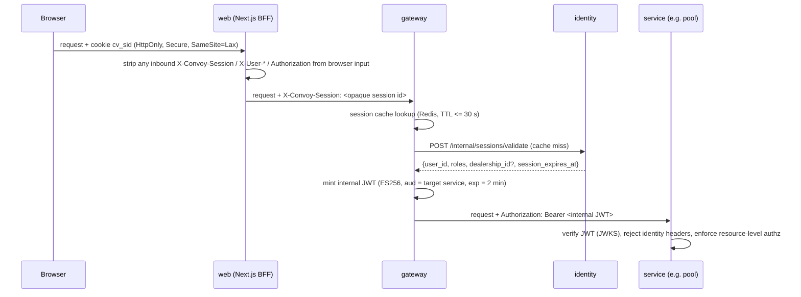

# Authentication contract (PLAN §4.4, ADR-006)

## 1. Browser ↔ web (BFF)
- Opaque session id: 256-bit random, base64url, cookie `cv_sid`; `HttpOnly; Secure; SameSite=Lax; Path=/; Max-Age=30d` (sliding: refreshed when < 7 days remain). Identity stores only `SHA-256(session_id)`.
- Login: email OTP (6 digits, 10 min, 5 attempts, rate limited per email hash and per IP) or passkey (WebAuthn, platform/cross-platform). Sessions are created only by identity via the BFF.
- CSRF: SameSite=Lax + BFF requires `Origin`/`Sec-Fetch-Site` same-origin on state-changing requests + a per-session CSRF token header for non-GET. 
- Logout: identity revokes the session (`revoked_at`), emits `SessionRevoked`.

## 2. web → gateway
- BFF forwards the session id in `X-Convoy-Session`. The BFF **removes** any `X-Convoy-*`, `X-User-*`, `X-Forwarded-User`, `Authorization` headers coming from the browser before forwarding (test AZ-INT-03).
- Network: gateway accepts traffic only from the web tasks' security group (full) / localhost network (lite) and from the realtime route; the Razorpay webhook path is the only unauthenticated route and is signature-checked by payment.

## 3. Gateway
- Validates the session with identity; caches the result in Redis **≤ 30 s**; `SessionRevoked` / `StaffRevoked` events evict the cache entry immediately (best effort) — the TTL is the guarantee.
- Mints an **internal JWT** per request (or reuses one for ≤ 30 s per (session, audience)):

| Claim | Value |
|---|---|
| `iss` | `convoy-gateway` |
| `aud` | target service name (`pool`, `quote`, …) — exactly one |
| `sub` | user id (uuid) |
| `roles` | array of `buyer` / `dealer_staff` / `dealer_admin` / `platform_admin` |
| `dealership_id` | present for dealer roles |
| `sid` | SHA-256 of session id (for audit correlation, not a credential) |
| `iat`, `nbf` | now |
| `exp` | now + **120 s** |
| `jti` | uuid (logged; not stored) |
| header `kid` | signing key id |

- Algorithm **ES256** (P-256). Private keys in KMS (full) / file with 0400 permissions generated at first boot (lite, documented limitation). Public keys published at `/.well-known/jwks.json` (internal).
- **Key rotation:** new key published to JWKS 24 h before it signs (`not_before`); gateway switches signing to it; old key remains in JWKS for 24 h after last use (> max token lifetime 2 min + cache 5 min); then removed. Rotation monthly and on demand; services cache JWKS ≤ 5 min and refetch on unknown `kid`.

## 4. Services
- Accept only the internal JWT (`iss`, `aud` = own name, `exp`, `nbf`, signature, clock skew ≤ 30 s). Reject requests carrying caller-supplied identity headers (`X-User-*`, `X-Convoy-Session`) with 400 and a security log line (AZ-INT-03).
- Enforce **resource-level authorisation** themselves (ownership, dealership match, pool membership) — the gateway only authenticates.
- Admin reads of sensitive data (buyer contact details, payment details, dispute evidence) write a `sensitive_access` audit record (AZ-T7).

## 5. Service tokens (service-to-service)
- Client credentials grant at identity `POST /internal/oauth/token` with `client_id` / secret (Secrets Manager); token is an ES256 JWT `{iss: convoy-identity, sub: <service>, aud: <callee>, scope: [..], exp: 5 min}`.
- Callers and scopes: pool → payment `deposits:create`; pool → quote `rounds:summary`; pool → dealer `eligibility:read`; pool → order `resolution:read`; services → identity `erasure:confirm`.
- Callees check `aud` and scope per endpoint (AZ-SVC-01..03). Human JWTs are never accepted on `/internal/**` and service tokens never on human endpoints.

## 6. Revocation timing
| Event | Takes effect | Measured by |
|---|---|---|
| Logout / admin revoke session | ≤ 30 s (cache TTL); usually immediate via event | AZ-T6 variant for buyers |
| Dealer staff revoked (E012) | **≤ 30 s** for API calls; SSE connections dropped on `StaffRevoked` and on next token refresh (realtime re-validates every 30 s) | **AZ-T6**: revoke, then poll a dealer endpoint every 1 s; assert first 401/403 at ≤ 30 s and none succeed after |
| Signing key compromise | remove `kid` from JWKS; services refetch ≤ 5 min; tokens expire ≤ 2 min | runbook drill P7 |
