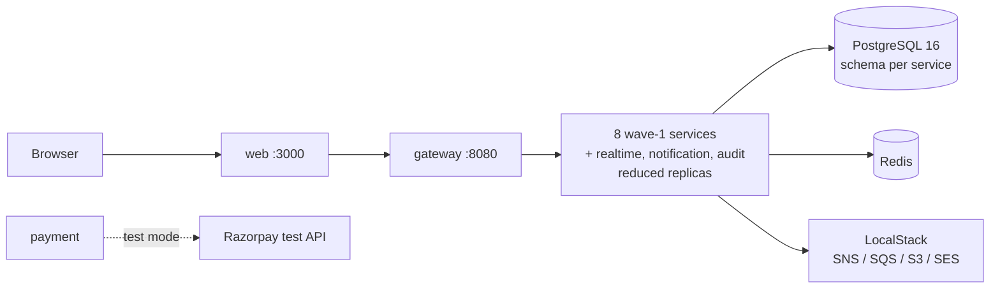
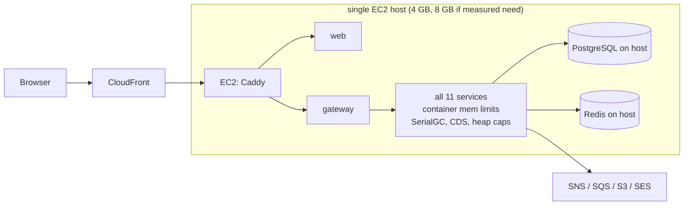
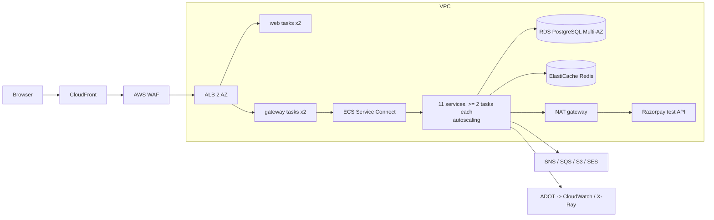

# Deployment profiles (PLAN §4.7, ADR-005)

Three profiles, one codebase, the same container images. Costs: [`../cost/aws-cost-estimate.md`](../cost/aws-cost-estimate.md).

## local (development)

Docker Compose. LocalStack for SNS/SQS/S3/SES; Razorpay test mode (webhooks via a tunnel or replayed fixtures).
- **May claim:** functional correctness, contract tests, messaging failure tests (§4.3) on LocalStack.
- **May not claim:** any latency, capacity, availability or cost figure.

## lite (always-on demo)

No ALB, no WAF, no NAT gateway (public subnet, security group allows only CloudFront origin-facing prefix list on 443 + SSM for admin; no SSH). Instance size chosen **after measuring** idle and peak memory in P6.
- **May claim:** "a working public demo", end-to-end journey, real AWS messaging integration, functional demos of failure isolation on one host.
- **May not claim:** availability, scale, latency SLOs, failover, multi-AZ, WAF protection, any load-test number.

## full (on demand, budgeted)

ECS Fargate across 2 AZs, ≥ 2 tasks per service, autoscaling on the scaling signal in services.md, RDS Multi-AZ, ElastiCache, ADOT/X-Ray. VPC endpoints for S3/SQS/SNS/ECR/Secrets Manager/CloudWatch (interface endpoints cost money — see cost estimate) to cut NAT data. Applied for a run, verified, destroyed with a teardown inventory check (PLAN §6).
- **May claim (only with measured evidence from a run):** W1–W9 capacity and latency, SSE 10k, failover (task kill, AZ task loss, RDS failover), isolation (notification/realtime/audit down), WAF-fronted edge.
- **May not claim:** 24×7 availability (it is not always on), production readiness, real-money behaviour.

| Claim | local | lite | full |
|---|---|---|---|
| Journey works end to end | ✓ | ✓ | ✓ |
| Messaging failure tests 1–6 | ✓ (LocalStack) | ✓ | ✓ |
| Latency p95/p99 (W9) | ✗ | ✗ | ✓ |
| 10k SSE / reconnect storm (W5) | ✗ | ✗ | ✓ |
| Deadline synchronised arrivals (W4) correctness | ✓ (correctness only) | ✓ (correctness only) | ✓ (+ throughput) |
| Failover / Multi-AZ | ✗ | ✗ | ✓ |
| Isolation of non-core services | ✓ (functional) | ✓ (functional) | ✓ (under load) |
| Cost per run | — | monthly | per hour / per run |
