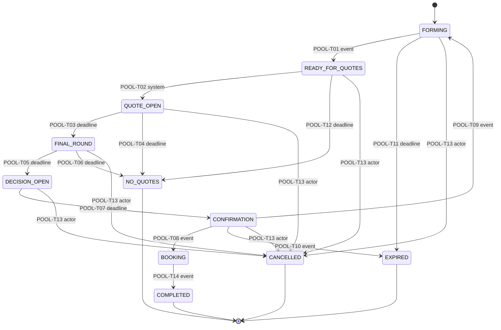
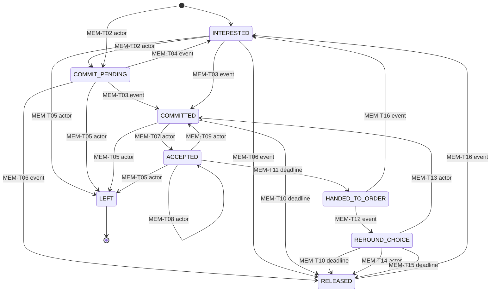
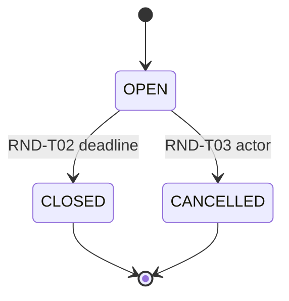
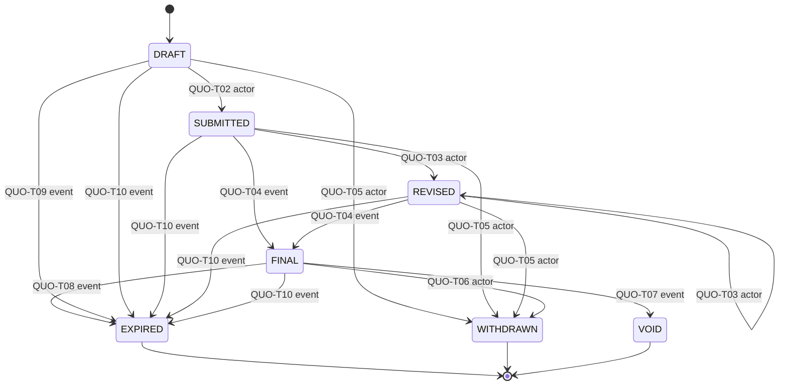
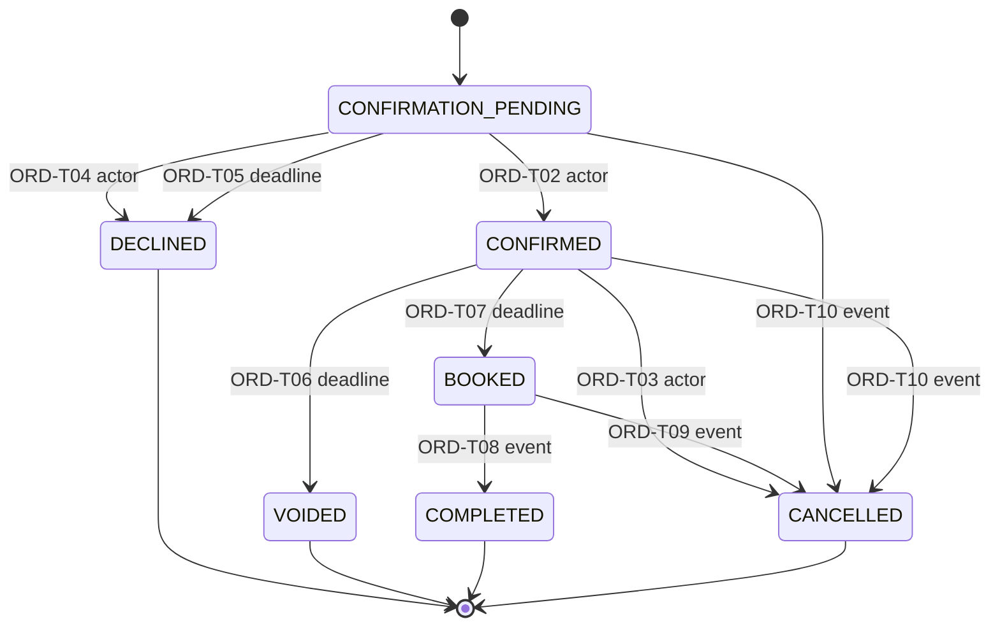
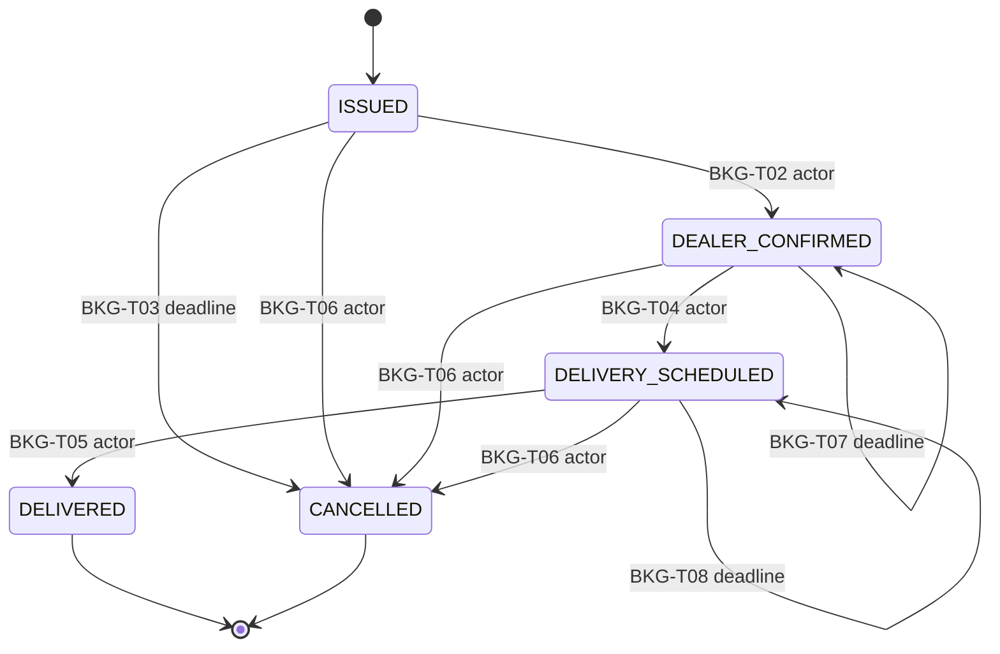
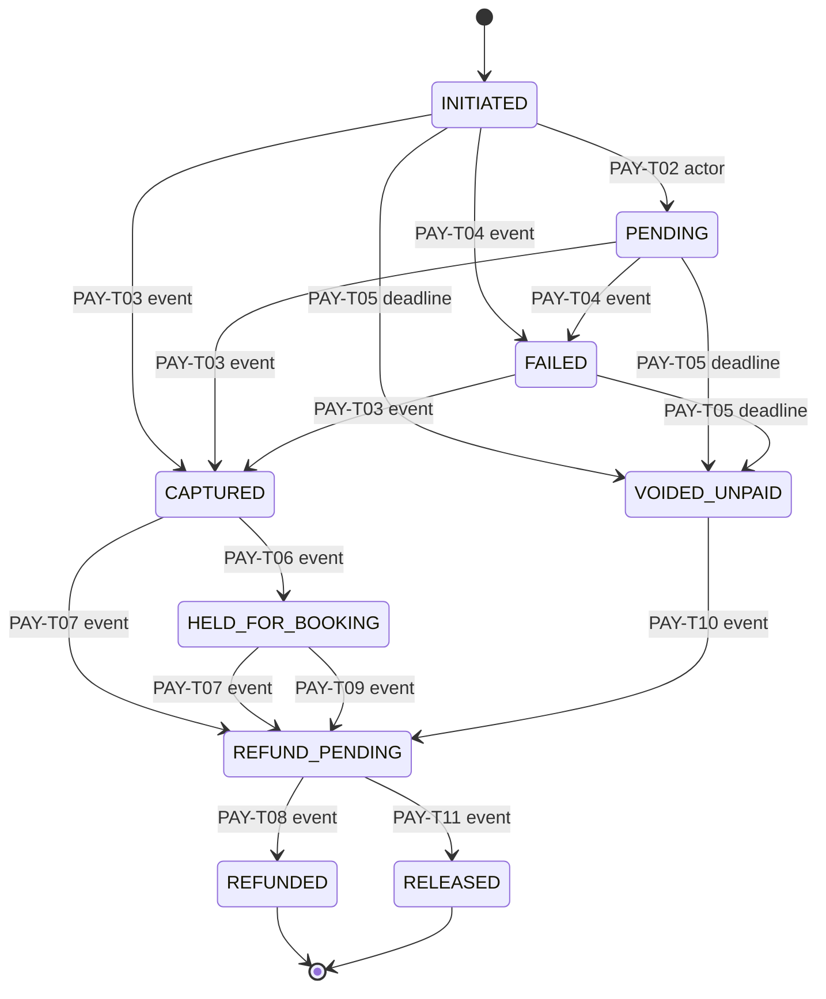
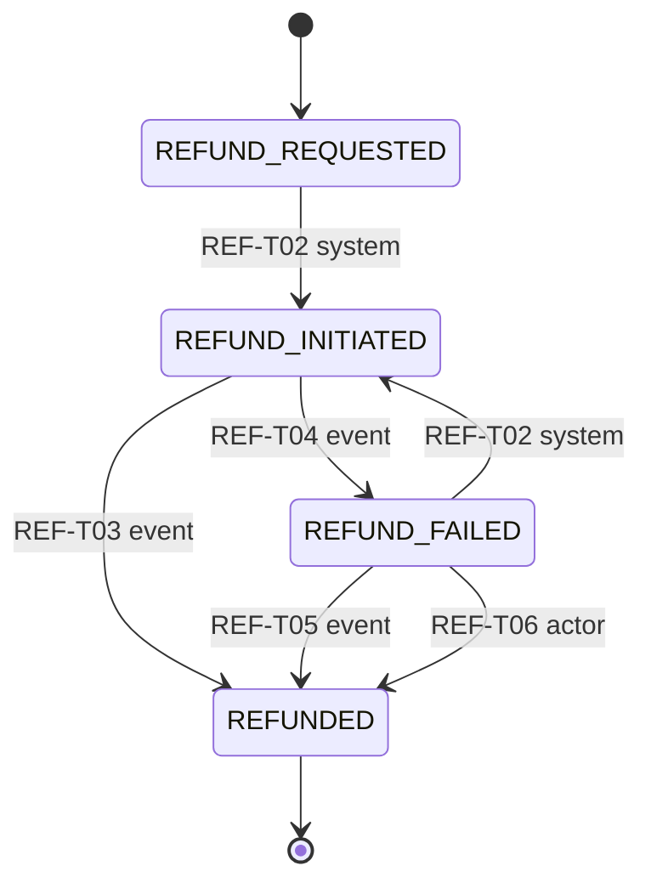
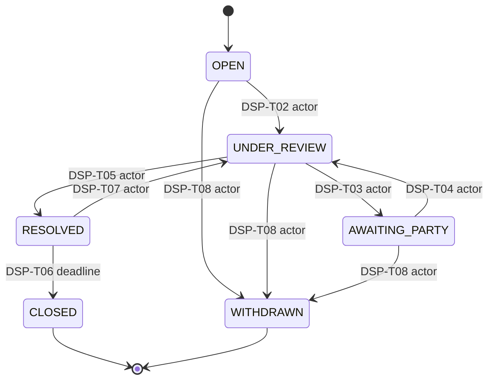

# State machines

Generated by `spec-tools/render_machines.py` from the YAML files in this folder. **Do not edit by hand**; edit the YAML and re-run.
The YAML files are the contract: later phases load them as test tables (`spec-tools/vectors/transitions.json` is derived from them).

Conventions: `(none)` = creation. `crash_points` / `idempotent_repeat` values in CAPS refer to [`_patterns.yaml`](_patterns.yaml).
Every (from, to) pair not listed is invalid and returns `409` with problem type `invalid-transition`; specific commands map to more precise problem types (see each machine's *Invalid commands* table and [`../../architecture/problem-types.yaml`](../../architecture/problem-types.yaml)).

## pool

Owner service: **pool** · aggregate `pool.pools` · source [`pool.yaml`](pool.yaml) · PLAN.md §2.1

Terminal states: `COMPLETED`, `EXPIRED`, `NO_QUOTES`, `CANCELLED`

| ID | From | To | Trigger | Guard | Emits |
|---|---|---|---|---|---|
| POOL-T01 | FORMING | READY_FOR_QUOTES | event: system | pools.state = 'FORMING' AND pools.version = :v AND pools.committed_count >= pools.min_members AND now_db() < pools.forming_deadline | PoolReady |
| POOL-T02 | READY_FOR_QUOTES | QUOTE_OPEN | system: pool | state = 'READY_FOR_QUOTES' AND version = :v AND eligible_dealer_count >= 1 (dealer API answer; verified dealership, same brand, same city, >= 1 active staff) | QuoteRoundOpened |
| POOL-T03 | QUOTE_OPEN | FINAL_ROUND | deadline: system | state = 'QUOTE_OPEN' AND version = :v AND now_db() >= rounds[1].deadline AND quote summary(round 1).valid_count >= 1 | RoundClosed, FinalRoundOpened |
| POOL-T04 | QUOTE_OPEN | NO_QUOTES | deadline: system | state = 'QUOTE_OPEN' AND version = :v AND now_db() >= rounds[1].deadline AND quote summary(round 1).valid_count = 0 | RoundClosed, PoolClosed |
| POOL-T05 | FINAL_ROUND | DECISION_OPEN | deadline: system | state = 'FINAL_ROUND' AND version = :v AND now_db() >= rounds[2].deadline AND quote summary(round 2).final_count >= 1 | RoundClosed, DecisionOpened |
| POOL-T06 | FINAL_ROUND | NO_QUOTES | deadline: system | state = 'FINAL_ROUND' AND version = :v AND now_db() >= rounds[2].deadline AND quote summary(round 2).final_count = 0 (every quote withdrawn) | RoundClosed, PoolClosed |
| POOL-T07 | DECISION_OPEN | CONFIRMATION | deadline: system | state = 'DECISION_OPEN' AND version = :v AND now_db() >= decision_deadline | AcceptancesFrozen |
| POOL-T08 | CONFIRMATION | BOOKING | event: system | state = 'CONFIRMATION' AND event.bookings_count >= 1 AND event.aggregate_version > pools.last_order_version_seen | PoolBookingStarted |
| POOL-T09 | CONFIRMATION | FORMING | event: system | state = 'CONFIRMATION' AND pools.round_set = 1 AND now_db() + forming_days + sealed + final + decision + confirmation durations <= purchase_window_end | PoolReopened |
| POOL-T10 | CONFIRMATION | EXPIRED | event: system | state = 'CONFIRMATION' AND NOT (POOL-T09 guard) | PoolClosed |
| POOL-T11 | FORMING | EXPIRED | deadline: system | state = 'FORMING' AND version = :v AND now_db() >= forming_deadline AND committed_count < min_members | PoolClosed |
| POOL-T12 | READY_FOR_QUOTES | NO_QUOTES | deadline: system | state = 'READY_FOR_QUOTES' AND version = :v AND now_db() >= dealer_wait_deadline | PoolClosed |
| POOL-T13 | FORMING, READY_FOR_QUOTES, QUOTE_OPEN, FINAL_ROUND, DECISION_OPEN, CONFIRMATION | CANCELLED | actor: platform_admin | state IN (listed) AND version = :If-Match AND reason_code IN (FRAUD_SUSPECTED, CATALOGUE_ERROR, DEALER_MISCONDUCT, DUPLICATE_POOL, OTHER) AND caller has role platform_admin | PoolClosed |
| POOL-T14 | BOOKING | COMPLETED | event: system | state = 'BOOKING' | PoolCompleted |

**Invalid commands**

| From | Attempt | Problem type |
|---|---|---|
| DECISION_OPEN, CONFIRMATION, BOOKING | join_interested | `invalid-transition` |
| QUOTE_OPEN | join_interested or commit committing at/after sealed_round_deadline | `deadline-passed` |
| FINAL_ROUND, DECISION_OPEN, CONFIRMATION, BOOKING | commit | `invalid-transition` |
| FORMING, READY_FOR_QUOTES, QUOTE_OPEN, FINAL_ROUND, CONFIRMATION, BOOKING | accept_quote | `invalid-transition` |
| DECISION_OPEN | accept_quote committing at/after decision_deadline | `deadline-passed` |
| DECISION_OPEN | accept_quote naming a quote that is not FINAL in this pool | `quote-not-final` |
| CONFIRMATION, BOOKING | leave | `invalid-transition` |
| BOOKING | admin_cancel | `invalid-transition` |
| COMPLETED, EXPIRED, NO_QUOTES, CANCELLED | any command | `invalid-transition` |
| * | any state-changing call with stale If-Match | `version-conflict` |
| * | any (from, to) pair not listed in transitions | `invalid-transition` |

All 102 invalid (from → to) state pairs → 409 invalid-transition

- `FORMING` ↛ FORMING, QUOTE_OPEN, FINAL_ROUND, DECISION_OPEN, CONFIRMATION, BOOKING, COMPLETED, NO_QUOTES
- `READY_FOR_QUOTES` ↛ FORMING, READY_FOR_QUOTES, FINAL_ROUND, DECISION_OPEN, CONFIRMATION, BOOKING, COMPLETED, EXPIRED
- `QUOTE_OPEN` ↛ FORMING, READY_FOR_QUOTES, QUOTE_OPEN, DECISION_OPEN, CONFIRMATION, BOOKING, COMPLETED, EXPIRED
- `FINAL_ROUND` ↛ FORMING, READY_FOR_QUOTES, QUOTE_OPEN, FINAL_ROUND, CONFIRMATION, BOOKING, COMPLETED, EXPIRED
- `DECISION_OPEN` ↛ FORMING, READY_FOR_QUOTES, QUOTE_OPEN, FINAL_ROUND, DECISION_OPEN, BOOKING, COMPLETED, EXPIRED, NO_QUOTES
- `CONFIRMATION` ↛ READY_FOR_QUOTES, QUOTE_OPEN, FINAL_ROUND, DECISION_OPEN, CONFIRMATION, COMPLETED, NO_QUOTES
- `BOOKING` ↛ FORMING, READY_FOR_QUOTES, QUOTE_OPEN, FINAL_ROUND, DECISION_OPEN, CONFIRMATION, BOOKING, EXPIRED, NO_QUOTES, CANCELLED
- `COMPLETED` ↛ FORMING, READY_FOR_QUOTES, QUOTE_OPEN, FINAL_ROUND, DECISION_OPEN, CONFIRMATION, BOOKING, COMPLETED, EXPIRED, NO_QUOTES, CANCELLED
- `EXPIRED` ↛ FORMING, READY_FOR_QUOTES, QUOTE_OPEN, FINAL_ROUND, DECISION_OPEN, CONFIRMATION, BOOKING, COMPLETED, EXPIRED, NO_QUOTES, CANCELLED
- `NO_QUOTES` ↛ FORMING, READY_FOR_QUOTES, QUOTE_OPEN, FINAL_ROUND, DECISION_OPEN, CONFIRMATION, BOOKING, COMPLETED, EXPIRED, NO_QUOTES, CANCELLED
- `CANCELLED` ↛ FORMING, READY_FOR_QUOTES, QUOTE_OPEN, FINAL_ROUND, DECISION_OPEN, CONFIRMATION, BOOKING, COMPLETED, EXPIRED, NO_QUOTES, CANCELLED

## membership

Owner service: **pool** · aggregate `pool.memberships` · source [`membership.yaml`](membership.yaml) · PLAN.md §2.1, §2.3, §3.1(4); added in P0 because commit/leave/accept drive counts, deposits and tiers (Q-004)

One row per (pool_id, buyer_id) - unique constraint. Partial unique index (buyer_id, model_id) WHERE state IN ('COMMIT_PENDING','COMMITTED','ACCEPTED') enforces one active commitment per model. Counts interested_count / committed_count on pool.pools are updated in the same transaction as the membership row (W3 exactness).

Terminal states: `LEFT`

| ID | From | To | Trigger | Guard | Emits |
|---|---|---|---|---|---|
| MEM-T01 | (none) | INTERESTED | actor: buyer | pool.state IN (FORMING, READY_FOR_QUOTES, QUOTE_OPEN) AND (pool.state <> 'QUOTE_OPEN' OR now_db() < rounds[1].deadline) AND no row for (pool, buyer) AND caller has role buyer and no dealer-staff role | MemberJoined |
| MEM-T02 | INTERESTED, (none) | COMMIT_PENDING | actor: buyer | MEM-T01 pool guard AND no other active commitment for this model (partial unique index) AND deposit terms version acknowledged in request (terms_version = current) | - |
| MEM-T03 | COMMIT_PENDING, INTERESTED | COMMITTED | event: system | event.payment_id = memberships.current_payment_id AND pool.state IN (FORMING, READY_FOR_QUOTES, QUOTE_OPEN) AND now_db() < (forming_deadline if FORMING, rounds[1].deadline if QUOTE_OPEN, no limit if READY_FOR_QUOTES) | MemberCommitted |
| MEM-T04 | COMMIT_PENDING | INTERESTED | event: system | event.payment_id = memberships.current_payment_id | - |
| MEM-T05 | INTERESTED, COMMIT_PENDING, COMMITTED, ACCEPTED | LEFT | actor: buyer | pool.state IN (FORMING, READY_FOR_QUOTES, QUOTE_OPEN, FINAL_ROUND, DECISION_OPEN) AND (pool.state <> 'DECISION_OPEN' OR now_db() < decision_deadline) | MemberLeft |
| MEM-T06 | COMMIT_PENDING, INTERESTED | RELEASED | event: system | NOT (MEM-T03 guard) AND event.payment_id = memberships.current_payment_id | MemberReleased |
| MEM-T07 | COMMITTED | ACCEPTED | actor: buyer | pool.state = 'DECISION_OPEN' AND now_db() < decision_deadline AND quote is FINAL in this pool (replicated from QuoteFinalised) AND variant is covered by the quote | AcceptanceChanged |
| MEM-T08 | ACCEPTED | ACCEPTED | actor: buyer | as MEM-T07 | AcceptanceChanged |
| MEM-T09 | ACCEPTED | COMMITTED | actor: buyer | pool.state = 'DECISION_OPEN' AND now_db() < decision_deadline | AcceptanceChanged |
| MEM-T10 | COMMITTED, REROUND_CHOICE | RELEASED | deadline: system | pool transition commits in the same transaction | - |
| MEM-T11 | ACCEPTED | HANDED_TO_ORDER | deadline: system | pool transition commits in the same transaction | - |
| MEM-T12 | HANDED_TO_ORDER | REROUND_CHOICE | event: system | pool transition commits in the same transaction | - |
| MEM-T13 | REROUND_CHOICE | COMMITTED | actor: buyer | now_db() < choice_deadline AND pool.state IN (FORMING, READY_FOR_QUOTES) AND pool.round_set = 2 | MemberCommitted |
| MEM-T14 | REROUND_CHOICE | RELEASED | actor: buyer | now_db() < choice_deadline | MemberReleased |
| MEM-T15 | REROUND_CHOICE | RELEASED | deadline: system | now_db() >= choice_deadline | MemberReleased |
| MEM-T16 | HANDED_TO_ORDER, RELEASED | INTERESTED | event: system | pool transition commits in the same transaction | - |

**Invalid commands**

| From | Attempt | Problem type |
|---|---|---|
| HANDED_TO_ORDER, LEFT, RELEASED | any buyer command | `invalid-transition` |
| REROUND_CHOICE | reround_choice committing at/after choice_deadline | `deadline-passed` |
| INTERESTED, COMMIT_PENDING, COMMITTED, ACCEPTED, HANDED_TO_ORDER, LEFT, RELEASED | reround_choice | `invalid-transition` |
| REROUND_CHOICE | leave or accept_quote (use reround_choice) | `invalid-transition` |
| INTERESTED, COMMIT_PENDING | accept_quote | `not-a-member` |
| (none) | join when a row exists | `already-member` |
| (none), INTERESTED | commit while another active commitment exists for the model | `active-commitment-exists` |
| * | stale If-Match | `version-conflict` |
| * | any (from, to) pair not listed in transitions | `invalid-transition` |

All 44 invalid (from → to) state pairs → 409 invalid-transition

- `INTERESTED` ↛ INTERESTED, ACCEPTED, HANDED_TO_ORDER, REROUND_CHOICE
- `COMMIT_PENDING` ↛ COMMIT_PENDING, ACCEPTED, HANDED_TO_ORDER, REROUND_CHOICE
- `COMMITTED` ↛ INTERESTED, COMMIT_PENDING, COMMITTED, HANDED_TO_ORDER, REROUND_CHOICE
- `ACCEPTED` ↛ INTERESTED, COMMIT_PENDING, REROUND_CHOICE, RELEASED
- `HANDED_TO_ORDER` ↛ COMMIT_PENDING, COMMITTED, ACCEPTED, HANDED_TO_ORDER, LEFT, RELEASED
- `REROUND_CHOICE` ↛ INTERESTED, COMMIT_PENDING, ACCEPTED, HANDED_TO_ORDER, REROUND_CHOICE, LEFT
- `LEFT` ↛ INTERESTED, COMMIT_PENDING, COMMITTED, ACCEPTED, HANDED_TO_ORDER, REROUND_CHOICE, LEFT, RELEASED
- `RELEASED` ↛ COMMIT_PENDING, COMMITTED, ACCEPTED, HANDED_TO_ORDER, REROUND_CHOICE, LEFT, RELEASED

## round

Owner service: **pool** · aggregate `pool.rounds` · source [`round.yaml`](round.yaml) · PLAN.md §2.1 (sealed round + one best-and-final round, §10.3)

At most 2 rounds per round_set (round_no 1 = SEALED, 2 = FINAL); round_set 2 exists only after the single re-round (POOL-T09). deadline is immutable once the round row commits; quote service stores a replica from QuoteRoundOpened / FinalRoundOpened and enforces it with its own DB clock (Q-006).

Terminal states: `CLOSED`, `CANCELLED`

| ID | From | To | Trigger | Guard | Emits |
|---|---|---|---|---|---|
| RND-T01 | (none) | OPEN | system: pool | enclosing pool transition guard; UNIQUE (pool_id, round_set, round_no) | QuoteRoundOpened |
| RND-T02 | OPEN | CLOSED | deadline: system | now_db() >= deadline | RoundClosed |
| RND-T03 | OPEN | CANCELLED | actor: platform_admin | enclosing POOL-T13 guard | - |

**Invalid commands**

| From | Attempt | Problem type |
|---|---|---|
| CLOSED, CANCELLED | submit, revise or withdraw a quote in this round | `deadline-passed` |
| (none) | submit a quote before the round replica exists in quote | `round-not-open` |
| OPEN | extend or change deadline | `invalid-transition` |
| * | any (from, to) pair not listed in transitions | `invalid-transition` |

All 7 invalid (from → to) state pairs → 409 invalid-transition

- `OPEN` ↛ OPEN
- `CLOSED` ↛ OPEN, CLOSED, CANCELLED
- `CANCELLED` ↛ OPEN, CLOSED, CANCELLED

## quote

Owner service: **quote** · aggregate `quote.quotes` · source [`quote.yaml`](quote.yaml) · PLAN.md §2.1 (DRAFT -> SUBMITTED -> REVISED* -> FINAL -> EXPIRED | WITHDRAWN | VOID), §2.2, §2.6, §3.1(5)

Every SUBMITTED/REVISED step writes an immutable quote.quote_versions row (full itemised input + price-engine snapshot hash + diff vs previous). FINAL is quiescent for quotes that win bookings; it stays FINAL with the resolved tier recorded.

Terminal states: `EXPIRED`, `WITHDRAWN`, `VOID`

| ID | From | To | Trigger | Guard | Emits |
|---|---|---|---|---|---|
| QUO-T01 | (none) | DRAFT | actor: dealer_staff | caller's dealership invited to round 1 of this pool (replica of QuoteRoundOpened.invited) AND staff active AND round replica OPEN AND now_db() < round.deadline AND no non-terminal quote from this dealership for this pool (unique) | - |
| QUO-T02 | DRAFT | SUBMITTED | actor: dealer_staff | state='DRAFT' AND version=:v AND round replica (round 1) OPEN AND now_db() < round.deadline (read in the committing transaction) AND price-engine validation passes (pricing-model.md §Validation) AND tiers valid (tier-resolution.md §Validation) AND valid_until >= confirmation horizon | QuoteSubmitted |
| QUO-T03 | SUBMITTED, REVISED | REVISED | actor: dealer_staff | version=:v AND current round replica OPEN (round 1 or round 2) AND now_db() < round.deadline AND validation passes AND (round 2 => dealership submitted in round 1) | QuoteRevised |
| QUO-T04 | SUBMITTED, REVISED | FINAL | event: system | quote belongs to the pool/round_set AND state IN (SUBMITTED, REVISED); latest version is the one with committed_at < final deadline (always true because later commits were rejected) | QuoteFinalised |
| QUO-T05 | DRAFT, SUBMITTED, REVISED | WITHDRAWN | actor: dealer_staff | version=:v AND current round replica OPEN AND now_db() < round.deadline | QuoteWithdrawn |
| QUO-T06 | FINAL | WITHDRAWN | actor: dealer_admin | version=:v (dealer_admin of the quote's dealership) | QuoteWithdrawn |
| QUO-T07 | FINAL | VOID | event: system | state='FINAL' AND event.quote_id = id | QuoteVoided |
| QUO-T08 | FINAL | EXPIRED | event: system | state='FINAL' | QuoteExpired |
| QUO-T09 | DRAFT | EXPIRED | event: system | state='DRAFT' | - |
| QUO-T10 | DRAFT, SUBMITTED, REVISED, FINAL | EXPIRED | event: system | state IN listed AND quote has no confirmed orders (true by construction: PoolClosed is never emitted after BOOKING) | QuoteExpired |

**Invalid commands**

| From | Attempt | Problem type |
|---|---|---|
| FINAL | revise | `invalid-transition` |
| SUBMITTED, REVISED | revise/withdraw committing at/after round deadline | `deadline-passed` |
| DRAFT | submit committing at/after round 1 deadline | `deadline-passed` |
| DRAFT | submit with invalid tiers | `invalid-tiers` |
| DRAFT, SUBMITTED, REVISED | submit/revise with discount above limit | `discount-exceeds-limit` |
| DRAFT, SUBMITTED, REVISED | submit/revise failing price validation | `quote-invalid` |
| SUBMITTED, REVISED, FINAL | edit fields in place (PATCH) | `invalid-transition` |
| DRAFT, SUBMITTED, REVISED | accept by buyer | `quote-not-final` |
| EXPIRED, WITHDRAWN, VOID | any command | `invalid-transition` |
| * | stale If-Match | `version-conflict` |
| * | any (from, to) pair not listed in transitions | `invalid-transition` |

All 35 invalid (from → to) state pairs → 409 invalid-transition

- `DRAFT` ↛ DRAFT, REVISED, FINAL, VOID
- `SUBMITTED` ↛ DRAFT, SUBMITTED, VOID
- `REVISED` ↛ DRAFT, SUBMITTED, VOID
- `FINAL` ↛ DRAFT, SUBMITTED, REVISED, FINAL
- `EXPIRED` ↛ DRAFT, SUBMITTED, REVISED, FINAL, EXPIRED, WITHDRAWN, VOID
- `WITHDRAWN` ↛ DRAFT, SUBMITTED, REVISED, FINAL, EXPIRED, WITHDRAWN, VOID
- `VOID` ↛ DRAFT, SUBMITTED, REVISED, FINAL, EXPIRED, WITHDRAWN, VOID

## order

Owner service: **order** · aggregate `order.orders` · source [`order.yaml`](order.yaml) · PLAN.md §2.2, §2.3, §2.6, §3.1(7-8); ADR-004 (order saga is orchestrated)

One order per accepting buyer per pool, created from AcceptancesFrozen. order is the saga orchestrator: it owns confirmation, tier resolution (one transaction per pool, order.pool_resolutions), booking issue, and asks payment to hold or refund the deposit. Saga state is persisted in order.saga_steps (step, status, attempts, next_attempt_at).

Terminal states: `DECLINED`, `VOIDED`, `COMPLETED`, `CANCELLED`

| ID | From | To | Trigger | Guard | Emits |
|---|---|---|---|---|---|
| ORD-T01 | (none) | CONFIRMATION_PENDING | event: system | UNIQUE (pool_id, buyer_id, round_set); quote replica is FINAL | OrderCreated |
| ORD-T02 | CONFIRMATION_PENDING | CONFIRMED | actor: buyer | version=:v AND buyer owns order AND now_db() < confirmation_deadline AND ceiling_snapshot_hash matches the stored CEILING snapshot AND quote replica not WITHDRAWN AND (quote.max_units IS NULL OR confirmed_count(quote) < max_units, checked under SELECT ... FOR UPDATE on order.quote_capacity) | ConfirmationRecorded |
| ORD-T03 | CONFIRMED | CANCELLED | actor: buyer | version=:v AND buyer owns order AND state='CONFIRMED' (tier not yet resolved) | OrderCancelled, DepositRefundRequested |
| ORD-T04 | CONFIRMATION_PENDING | DECLINED | actor: buyer | buyer owns order AND now_db() < confirmation_deadline | ConfirmationDeclined, DepositRefundRequested |
| ORD-T05 | CONFIRMATION_PENDING | DECLINED | deadline: system | now_db() >= confirmation_deadline | ConfirmationDeclined, DepositRefundRequested |
| ORD-T06 | CONFIRMED | VOIDED | deadline: system | now_db() >= confirmation_deadline AND pool_resolutions.state='PENDING' AND confirmed_count_at_deadline(quote) < quote.min_fulfilment | TierResolved, DepositRefundRequested, BookingsIssued |
| ORD-T07 | CONFIRMED | BOOKED | deadline: system | now_db() >= confirmation_deadline AND pool_resolutions.state='PENDING' AND confirmed_count_at_deadline(quote) >= quote.min_fulfilment | TierResolved, BookingIssued, DepositHoldRequested, StockReservationRequested, BookingsIssued |
| ORD-T08 | BOOKED | COMPLETED | event: system | booking.state='DELIVERED' | AllBookingsClosed |
| ORD-T09 | BOOKED | CANCELLED | event: system | booking.state='CANCELLED' | OrderCancelled, DepositRefundRequested, AllBookingsClosed |
| ORD-T10 | CONFIRMATION_PENDING, CONFIRMED | CANCELLED | event: system | order.quote_id = event.quote_id | OrderCancelled, DepositRefundRequested, DisputeOpened |

**Invalid commands**

| From | Attempt | Problem type |
|---|---|---|
| CONFIRMATION_PENDING | confirm committing at/after confirmation_deadline | `deadline-passed` |
| CONFIRMATION_PENDING | confirm when capacity full | `capacity-reached` |
| CONFIRMATION_PENDING | confirm with stale ceiling_snapshot_hash | `version-conflict` |
| CONFIRMED, BOOKED | confirm | `invalid-transition` |
| CONFIRMATION_PENDING | cancel (use decline) | `invalid-transition` |
| BOOKED | cancel on order (cancel the booking) | `invalid-transition` |
| DECLINED, VOIDED, COMPLETED, CANCELLED | any command | `invalid-transition` |
| * | stale If-Match | `version-conflict` |
| * | any (from, to) pair not listed in transitions | `invalid-transition` |

All 41 invalid (from → to) state pairs → 409 invalid-transition

- `CONFIRMATION_PENDING` ↛ CONFIRMATION_PENDING, VOIDED, BOOKED, COMPLETED
- `CONFIRMED` ↛ CONFIRMATION_PENDING, CONFIRMED, DECLINED, COMPLETED
- `DECLINED` ↛ CONFIRMATION_PENDING, CONFIRMED, DECLINED, VOIDED, BOOKED, COMPLETED, CANCELLED
- `VOIDED` ↛ CONFIRMATION_PENDING, CONFIRMED, DECLINED, VOIDED, BOOKED, COMPLETED, CANCELLED
- `BOOKED` ↛ CONFIRMATION_PENDING, CONFIRMED, DECLINED, VOIDED, BOOKED
- `COMPLETED` ↛ CONFIRMATION_PENDING, CONFIRMED, DECLINED, VOIDED, BOOKED, COMPLETED, CANCELLED
- `CANCELLED` ↛ CONFIRMATION_PENDING, CONFIRMED, DECLINED, VOIDED, BOOKED, COMPLETED, CANCELLED

## booking

Owner service: **order** · aggregate `order.bookings` · source [`booking.yaml`](booking.yaml) · PLAN.md §2.6, §3.1(8) (booking issued -> dealer confirmed -> delivery scheduled -> delivered / cancelled), voucher with QR verification

1:1 with a BOOKED order. voucher_code = 128-bit random, QR encodes a signed token (ES256, kid) {booking_id, voucher_code, exp}; dealer scans it at handover. promised_delivery_date comes from the quote's stock claim for the variant/colour.

Terminal states: `DELIVERED`, `CANCELLED`

| ID | From | To | Trigger | Guard | Emits |
|---|---|---|---|---|---|
| BKG-T01 | (none) | ISSUED | deadline: system | UNIQUE (order_id) | BookingIssued |
| BKG-T02 | ISSUED | DEALER_CONFIRMED | actor: dealer_staff | staff belongs to booking.dealership_id AND now_db() < dealer_confirm_deadline AND saga step RESERVE_STOCK = DONE | BookingConfirmedByDealer |
| BKG-T03 | ISSUED | CANCELLED | deadline: system | state='ISSUED' AND (now_db() >= dealer_confirm_deadline OR stock reservation failed) | BookingCancelled, DisputeOpened |
| BKG-T04 | DEALER_CONFIRMED, DELIVERY_SCHEDULED | DELIVERY_SCHEDULED | actor: dealer_staff | staff belongs to dealership AND scheduled_date >= today_ist() | DeliveryScheduled |
| BKG-T05 | DELIVERY_SCHEDULED | DELIVERED | actor: dealer_staff | voucher token signature valid, not expired, matches booking AND staff belongs to dealership | BookingDelivered |
| BKG-T06 | ISSUED, DEALER_CONFIRMED, DELIVERY_SCHEDULED | CANCELLED | actor: buyer | dealer_admin | platform_admin | system | caller owns the booking (buyer) or its dealership (dealer_admin) or is platform_admin; reason code valid for the actor | BookingCancelled, DisputeOpened |
| BKG-T07 | DEALER_CONFIRMED | DEALER_CONFIRMED | deadline: system | today_ist() > promised_delivery_date + grace_days (default 7) AND overdue_flag = false | BookingOverdue |
| BKG-T08 | DELIVERY_SCHEDULED | DELIVERY_SCHEDULED | deadline: system | as BKG-T07 | BookingOverdue |

**Invalid commands**

| From | Attempt | Problem type |
|---|---|---|
| ISSUED | dealer confirm at/after dealer_confirm_deadline | `deadline-passed` |
| ISSUED | schedule delivery before dealer confirmation | `invalid-transition` |
| ISSUED, DEALER_CONFIRMED | deliver | `invalid-transition` |
| DELIVERED | cancel | `invalid-transition` |
| * | deliver with invalid voucher token | `forbidden` |
| DELIVERED, CANCELLED | any command | `invalid-transition` |
| * | stale If-Match | `version-conflict` |
| * | any (from, to) pair not listed in transitions | `invalid-transition` |

All 17 invalid (from → to) state pairs → 409 invalid-transition

- `ISSUED` ↛ ISSUED, DELIVERY_SCHEDULED, DELIVERED
- `DEALER_CONFIRMED` ↛ ISSUED, DELIVERED
- `DELIVERY_SCHEDULED` ↛ ISSUED, DEALER_CONFIRMED
- `DELIVERED` ↛ ISSUED, DEALER_CONFIRMED, DELIVERY_SCHEDULED, DELIVERED, CANCELLED
- `CANCELLED` ↛ ISSUED, DEALER_CONFIRMED, DELIVERY_SCHEDULED, DELIVERED, CANCELLED

## payment

Owner service: **payment** · aggregate `payment.payments` · source [`payment.yaml`](payment.yaml) · PLAN.md §2.3 (INITIATED -> PENDING -> CAPTURED | FAILED; CAPTURED -> APPLIED_TO_BOOKING, renamed HELD_FOR_BOOKING by AMENDMENT-003); deposit-contract.md

One row per deposit attempt = one Razorpay order (test mode). Idempotency key deposit:{buyer_id}:{pool_id}:{round_set} is UNIQUE. The deposit is a refundable commitment token and is never paid to the dealer (AMENDMENT-003). Terminal outcomes are REFUNDED (returned because the purchase did not go ahead) or RELEASED (returned after delivery); both return the full amount through a refund aggregate. REFUND_PENDING and VOIDED_UNPAID are P0 additions (Q-010); RELEASED replaces P0's SETTLED. Every state change that moves money posts a balanced journal entry in the same transaction (deposit-contract.md §Ledger).

Terminal states: `REFUNDED`, `RELEASED`

| ID | From | To | Trigger | Guard | Emits |
|---|---|---|---|---|---|
| PAY-T01 | (none) | INITIATED | system: pool | UNIQUE deposit key; amount_paise = configured deposit (default 99900) | - |
| PAY-T02 | INITIATED | PENDING | actor: buyer | HMAC-SHA256(order_id/payment_id, key_secret) == signature (callback) or webhook signature valid | - |
| PAY-T03 | INITIATED, PENDING, FAILED | CAPTURED | event: system | X-Razorpay-Signature valid over raw body AND x-razorpay-event-id not in payment.webhook_inbox AND entity.order_id = razorpay_order_id AND amount = amount_paise AND currency = INR | PaymentCaptured |
| PAY-T04 | INITIATED, PENDING | FAILED | event: system | signature valid AND event id new AND order_id matches | PaymentFailed |
| PAY-T05 | INITIATED, PENDING, FAILED | VOIDED_UNPAID | deadline: system | state IN listed | PaymentVoided |
| PAY-T06 | CAPTURED | HELD_FOR_BOOKING | event: system | state='CAPTURED' AND event.payment matches buyer+pool | DepositHeld |
| PAY-T07 | CAPTURED, HELD_FOR_BOOKING | REFUND_PENDING | event: system | state IN listed AND no refund exists for payment_id (UNIQUE refunds.payment_id) | RefundRequested |
| PAY-T08 | REFUND_PENDING | REFUNDED | event: system | refund.state='REFUNDED' AND refund.kind='REFUND' | - |
| PAY-T09 | HELD_FOR_BOOKING | REFUND_PENDING | event: system | booking_id matches AND no refund exists for payment_id | RefundRequested |
| PAY-T10 | VOIDED_UNPAID | REFUND_PENDING | event: system | signature valid AND event id new AND refund_on_capture=true | PaymentCaptured, RefundRequested |
| PAY-T11 | REFUND_PENDING | RELEASED | event: system | refund.state='REFUNDED' AND refund.kind='RELEASE' | DepositReleased |

**Invalid commands**

| From | Attempt | Problem type |
|---|---|---|
| INITIATED, PENDING | set CAPTURED from browser callback or API poll | `invalid-transition` |
| * | webhook with bad signature | `webhook-signature-invalid` |
| INITIATED, PENDING, FAILED, VOIDED_UNPAID | hold for booking | `deposit-not-captured` |
| REFUNDED, RELEASED | any command | `invalid-transition` |
| REFUND_PENDING | hold for booking | `invalid-transition` |
| * | any (from, to) pair not listed in transitions | `invalid-transition` |

All 66 invalid (from → to) state pairs → 409 invalid-transition

- `INITIATED` ↛ INITIATED, HELD_FOR_BOOKING, REFUND_PENDING, REFUNDED, RELEASED
- `PENDING` ↛ INITIATED, PENDING, HELD_FOR_BOOKING, REFUND_PENDING, REFUNDED, RELEASED
- `CAPTURED` ↛ INITIATED, PENDING, CAPTURED, FAILED, VOIDED_UNPAID, REFUNDED, RELEASED
- `FAILED` ↛ INITIATED, PENDING, FAILED, HELD_FOR_BOOKING, REFUND_PENDING, REFUNDED, RELEASED
- `VOIDED_UNPAID` ↛ INITIATED, PENDING, CAPTURED, FAILED, VOIDED_UNPAID, HELD_FOR_BOOKING, REFUNDED, RELEASED
- `HELD_FOR_BOOKING` ↛ INITIATED, PENDING, CAPTURED, FAILED, VOIDED_UNPAID, HELD_FOR_BOOKING, REFUNDED, RELEASED
- `REFUND_PENDING` ↛ INITIATED, PENDING, CAPTURED, FAILED, VOIDED_UNPAID, HELD_FOR_BOOKING, REFUND_PENDING
- `REFUNDED` ↛ INITIATED, PENDING, CAPTURED, FAILED, VOIDED_UNPAID, HELD_FOR_BOOKING, REFUND_PENDING, REFUNDED, RELEASED
- `RELEASED` ↛ INITIATED, PENDING, CAPTURED, FAILED, VOIDED_UNPAID, HELD_FOR_BOOKING, REFUND_PENDING, REFUNDED, RELEASED

## refund

Owner service: **payment** · aggregate `payment.refunds` · source [`refund.yaml`](refund.yaml) · PLAN.md §2.3 (REFUND_REQUESTED -> REFUND_INITIATED -> REFUNDED | REFUND_FAILED; retry with backoff, then alert + admin queue)

Full refunds only (deposit amount). UNIQUE (payment_id). kind = REFUND (purchase did not go ahead -> payment REFUNDED) or RELEASE (booking delivered -> payment RELEASED, AMENDMENT-003); the Razorpay call and webhooks are identical for both. Retry schedule: 1 min, 5 min, 30 min, 2 h, 12 h (5 attempts) then REFUND_FAILED stays and alarm REFUND_STUCK + admin queue. Razorpay refund call carries receipt = refund_id; before any (re)try the worker looks up existing refunds on the payment and adopts one whose receipt matches, so a crash after the API call never creates a second refund.

Terminal states: `REFUNDED`

| ID | From | To | Trigger | Guard | Emits |
|---|---|---|---|---|---|
| REF-T01 | (none) | REFUND_REQUESTED | event: system | UNIQUE (payment_id) | RefundRequested |
| REF-T02 | REFUND_REQUESTED, REFUND_FAILED | REFUND_INITIATED | system: payment | state IN listed AND (next_attempt_at <= now_db() OR admin retry) AND attempts < 5 (system)  | - |
| REF-T03 | REFUND_INITIATED | REFUNDED | event: system | signature valid AND event id new AND refund id matches | RefundCompleted |
| REF-T04 | REFUND_INITIATED | REFUND_FAILED | event: system | signature valid AND event id new | RefundFailed |
| REF-T05 | REFUND_FAILED | REFUNDED | event: system | signature valid AND event id new | RefundCompleted |
| REF-T06 | REFUND_FAILED | REFUNDED | actor: platform_admin | attempts >= 5 AND requester and approver both platform_admin AND approver <> requester (AMENDMENT-001: every manual refund, ledger adjustment or override needs a second admin, whatever the amount) | RefundCompleted |

**Invalid commands**

| From | Attempt | Problem type |
|---|---|---|
| REFUND_REQUESTED, REFUND_INITIATED | admin manual resolve | `invalid-transition` |
| REFUND_FAILED | manual resolve without approval by a second, different admin | `second-approval-required` |
| REFUNDED | any command | `invalid-transition` |
| * | webhook with bad signature | `webhook-signature-invalid` |
| * | any (from, to) pair not listed in transitions | `invalid-transition` |

All 11 invalid (from → to) state pairs → 409 invalid-transition

- `REFUND_REQUESTED` ↛ REFUND_REQUESTED, REFUND_FAILED, REFUNDED
- `REFUND_INITIATED` ↛ REFUND_REQUESTED, REFUND_INITIATED
- `REFUND_FAILED` ↛ REFUND_REQUESTED, REFUND_FAILED
- `REFUNDED` ↛ REFUND_REQUESTED, REFUND_INITIATED, REFUND_FAILED, REFUNDED

## dispute

Owner service: **order** · aggregate `order.disputes` · source [`dispute.yaml`](dispute.yaml) · PLAN.md §2.6, §3.1(9) (category, evidence attachments in S3, status, owner, resolution history)

Categories: NOT_DELIVERED, DELIVERY_OVERDUE, PRICE_NOT_HONOURED, STOCK_UNAVAILABLE, DEALER_CANCELLED, DEALER_NOT_HONOURED, WRONG_VARIANT, CHARGES_DISPUTE, REFUND_NOT_RECEIVED, OTHER. Evidence = S3 objects uploaded via presigned PUT (max 10 files, 10 MB each, image/pdf). Every transition appends to order.dispute_history (actor, from, to, note, at).

Terminal states: `CLOSED`, `WITHDRAWN`

| ID | From | To | Trigger | Guard | Emits |
|---|---|---|---|---|---|
| DSP-T01 | (none) | OPEN | actor: buyer | system | buyer owns the order AND order.state IN (BOOKED, COMPLETED, CANCELLED) AND no non-terminal dispute of the same category on this order | DisputeOpened |
| DSP-T02 | OPEN | UNDER_REVIEW | actor: platform_admin | caller platform_admin | DisputeStatusChanged |
| DSP-T03 | UNDER_REVIEW | AWAITING_PARTY | actor: platform_admin | caller is the owner | DisputeStatusChanged |
| DSP-T04 | AWAITING_PARTY | UNDER_REVIEW | actor: buyer | dealer_staff | system | caller is the awaited party, or now_db() >= respond_by (system, records NO_RESPONSE) | DisputeStatusChanged |
| DSP-T05 | UNDER_REVIEW | RESOLVED | actor: platform_admin | caller is the owner AND outcome IN (REFUND_BUYER, CANCEL_BOOKING, DEALER_WARNING, PRICE_ADJUSTMENT_RECORDED, NO_ACTION) AND (outcome IN (REFUND_BUYER, CANCEL_BOOKING) => approved by a second, different platform_admin, AMENDMENT-001) | DisputeResolved |
| DSP-T06 | RESOLVED | CLOSED | deadline: system | now_db() >= appeal_until OR appeal_decided | DisputeStatusChanged |
| DSP-T07 | RESOLVED | UNDER_REVIEW | actor: buyer | buyer owns AND now_db() < appeal_until AND appeal_count = 0 | DisputeStatusChanged |
| DSP-T08 | OPEN, UNDER_REVIEW, AWAITING_PARTY | WITHDRAWN | actor: buyer | buyer owns AND opened_by = buyer (system-opened disputes cannot be withdrawn by the buyer) | DisputeStatusChanged |

**Invalid commands**

| From | Attempt | Problem type |
|---|---|---|
| RESOLVED | second appeal | `invalid-transition` |
| OPEN, AWAITING_PARTY | resolve | `invalid-transition` |
| * | dealer reads dispute of another dealership | `not-found` |
| CLOSED, WITHDRAWN | any command | `invalid-transition` |
| * | money outcome (REFUND_BUYER, CANCEL_BOOKING) without approval by a second admin | `second-approval-required` |
| * | any (from, to) pair not listed in transitions | `invalid-transition` |

All 27 invalid (from → to) state pairs → 409 invalid-transition

- `OPEN` ↛ OPEN, AWAITING_PARTY, RESOLVED, CLOSED
- `UNDER_REVIEW` ↛ OPEN, UNDER_REVIEW, CLOSED
- `AWAITING_PARTY` ↛ OPEN, AWAITING_PARTY, RESOLVED, CLOSED
- `RESOLVED` ↛ OPEN, AWAITING_PARTY, RESOLVED, WITHDRAWN
- `CLOSED` ↛ OPEN, UNDER_REVIEW, AWAITING_PARTY, RESOLVED, CLOSED, WITHDRAWN
- `WITHDRAWN` ↛ OPEN, UNDER_REVIEW, AWAITING_PARTY, RESOLVED, CLOSED, WITHDRAWN

